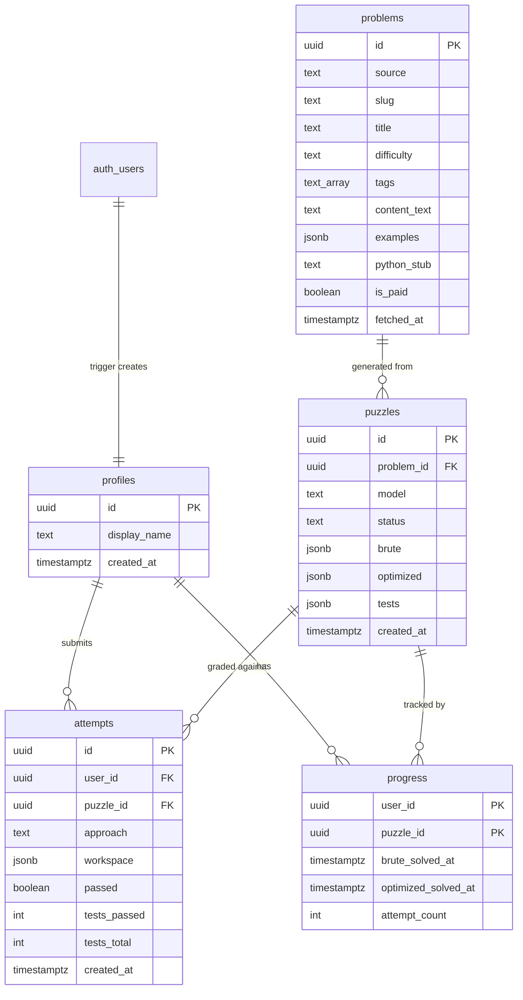
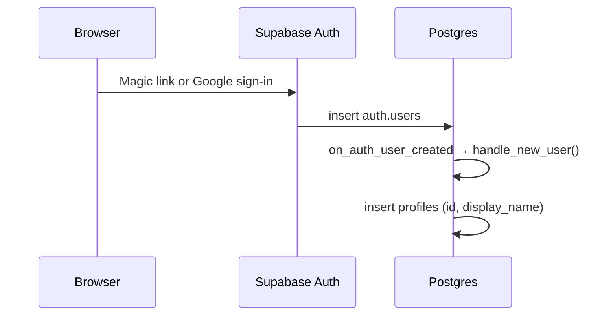
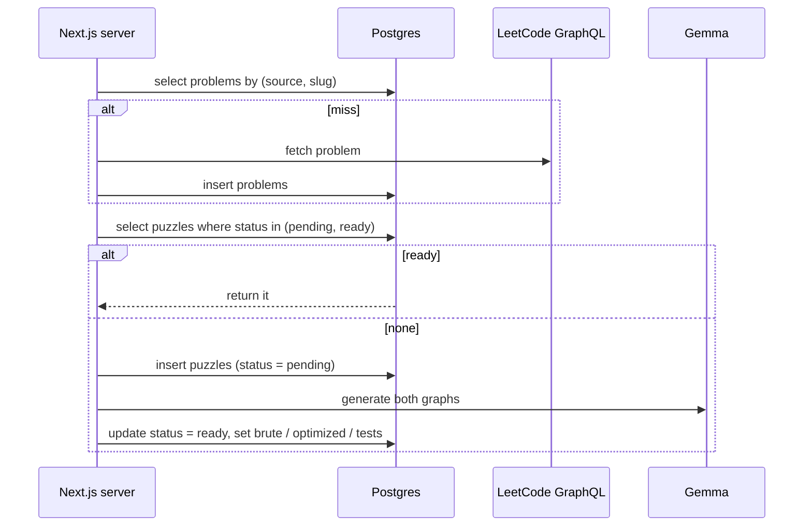
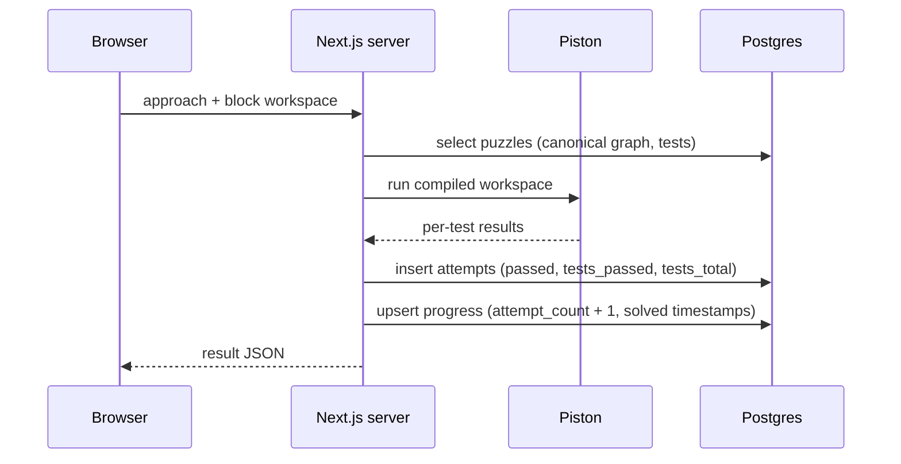

# LeetBloc database

This document covers how LeetBloc's data is stored in Supabase (Postgres, Auth, Row Level Security) and who is allowed to read or write each table. The product design is in [DESIGN.md](./DESIGN.md). The schema itself is in [`supabase/migrations/`](./supabase/migrations/).

One rule shapes everything here: the browser can read its own progress and the public problem text, and nothing else. It cannot read solution graphs or hidden tests, and it cannot write a grade. Every write that matters goes through the Next.js server, which uses the service role.

## Tables



| Table | Holds | Migration |
| --- | --- | --- |
| `profiles` | One row per Auth user | `20261024000001_profiles.sql` |
| `problems` | Cached LeetCode and bundled problem text | `20261024000002_problems.sql` |
| `puzzles` | Gemma's generation for a problem: both canonical graphs and the agreed tests | `20261024000003_puzzles.sql` |
| `attempts` | Every check a signed-in learner runs | `20261024000004_attempts_and_progress.sql` |
| `progress` | One row per user per puzzle, which the progress page renders | `20261024000004_attempts_and_progress.sql` |

Fixed sets of values are stored as `text` with `check` constraints, not Postgres enums, so adding a value later is a one-line migration:

- `problems.source`: `leetcode`, `bundled`
- `problems.difficulty`: `Easy`, `Medium`, `Hard`
- `puzzles.status`: `pending`, `ready`, `failed`
- `attempts.approach`: `brute`, `optimized`

## Who can do what

| Table | `anon` | `authenticated` | Service role (server) |
| --- | --- | --- | --- |
| `profiles` | — | Read own row. Update `display_name` only. | All |
| `problems` | Read where `is_paid = false` | Read where `is_paid = false` | All |
| `puzzles` | — | — | All |
| `attempts` | — | Read own rows | All |
| `progress` | — | Read own rows | All |

Two layers enforce this. Row Level Security is enabled on every table, and the policies above are the only ones that exist. Table grants are also revoked, so the client roles have no `insert`, `update`, or `delete` on any table, apart from a column grant for `profiles.display_name`. `puzzles` has every grant revoked, so a request for it through PostgREST fails with "permission denied" and never just returns an empty list.

Policies compare against `(select auth.uid())` instead of a bare `auth.uid()`. Postgres then evaluates it once per query, not once per row.

## Flows

### Sign-up



`handle_new_user()` runs as `security definer` with an empty `search_path`, so it can write `profiles` no matter who triggered it. The display name is the first non-empty value of:

1. `raw_user_meta_data.full_name` (Google)
2. `raw_user_meta_data.name`
3. The part of the email before the `@` (magic link)

Client roles cannot call the function directly.

### Loading a puzzle (`POST /api/puzzles`)



**Problems** are cached by `(source, slug)`, which is unique. A paid problem is stored with `is_paid = true` so it is never fetched again, and the read policy hides it from clients.

**Puzzles** are deduped by a partial unique index, `puzzles_one_live_per_problem`, on `problem_id` where `status` is `pending` or `ready`. Only one generation can be running or finished for a problem at a time. If two requests for Two Sum arrive together, the second `pending` insert fails with a unique violation. The server catches that and waits for, or reads, the first row and does not call Gemma again.

`failed` rows don't count toward the index, so they stay as a record of failed generations. To retry after a failure, or to take over an abandoned `pending` row (one more than a couple of minutes old by `created_at`), the server:

1. Updates the old row to `status = 'failed'`.
2. Inserts a new `pending` row.

If it skips step 1, step 2 is rejected.

`brute`, `optimized`, and `tests` may be null while a row is `pending` or `failed`. A check constraint requires all three before a row can become `ready`, and `tests` must be a JSON array.

### Grading a check (`POST /api/puzzles/:id/attempts`)



The server computes `passed` itself. For the optimized round, that means every test passes and every `required` block is present. Then it writes both rows. The upsert on `progress` should:

- Insert `(user_id, puzzle_id, attempt_count = 1)` on the first check, or increment `attempt_count` on each later one.
- Set `brute_solved_at` the first time a brute-force attempt passes, and also when an optimized solution passes in the brute-force round (they skip ahead).
- Set `optimized_solved_at` the first time an optimized-round attempt passes.
- Never overwrite a solved timestamp once it is set. Use `coalesce(existing, now())`.

The client never writes either table, so a passing grade can only come from this route. That is the point of the design. If the browser could write `progress`, the progress page would mean nothing.

A visitor who isn't signed in gets a result but no rows. When they sign in, the client posts the attempt again and the server grades it again. `attempts.user_id` allows null, as DESIGN.md specifies, but the server never writes a row without a user.

Constraints keep the counts sane: `tests_passed` and `tests_total` can't go below zero, `tests_passed <= tests_total`, and `attempt_count >= 0`.

### Reading progress (`GET /api/me/progress`)

The progress page can read `progress` directly with the anon key and the user's session. Row Level Security limits the result to the user's own rows. Problem titles come from a join through `puzzles` to `problems`. The client can't read `puzzles`, so the server route does that join and returns only the titles and statuses.

## Indexes

| Index | Serves |
| --- | --- |
| `problems (source, slug)` unique | Cache lookup on paste |
| `puzzles_one_live_per_problem` partial unique | Generation dedupe |
| `puzzles (problem_id)` | Puzzle lookup by problem, including failed history |
| `attempts (user_id, puzzle_id, created_at desc)` | A user's history on one puzzle, most recent first |
| `attempts (puzzle_id)` | Foreign key, cascade deletes |
| `progress (user_id, puzzle_id)` primary key | The progress page and the upsert |
| `progress (puzzle_id)` | Foreign key, cascade deletes |

## Deletes

Deletes cascade down the tree. Deleting an Auth user removes their profile, attempts, and progress. Deleting a problem removes its puzzles, and with them every attempt and progress row for those puzzles. Nothing in the app deletes problems or puzzles today. These rules exist so that cleanup by hand doesn't leave orphaned rows.

## Applying the migrations

The Supabase CLI is not part of the repo yet.

```sh
supabase init            # creates supabase/config.toml, keeps migrations/
supabase start           # local stack, applies migrations
supabase db reset        # re-apply from scratch

supabase link --project-ref <ref>
supabase db push         # apply to the hosted project
```

New schema changes go in a new timestamped file in `supabase/migrations/`. Never edit a migration that has already been pushed.

## Open questions

- **`attempts.user_id` nullability.** DESIGN.md says it can be null but visitor rows are never written. Making it `not null` would turn that rule into a constraint.
- **Workspace autosave.** DESIGN.md saves the block workspace every few seconds while signed in. No table holds a draft that hasn't been checked yet. A `workspace` column on `progress`, one per approach, would cover it.
- **Progress upsert as a function.** The `progress` rules above live in the server route today. Moving them into a `security definer` function, called from the route, would make them atomic with the `attempts` insert.
