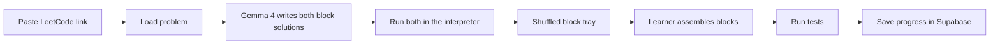

# LeetBloc

LeetBloc turns a LeetCode problem into a Scratch-style puzzle. A learner pastes a problem link. Gemma 4 writes two solutions, a brute-force one and an optimized one, as blocks. The learner snaps those blocks together and submits. The puzzle is solved when the assembled program passes the tests.

The point is the path into the problem, not a scoreboard. Someone who does not know how to start a LeetCode problem can still see the plan, place the steps, and watch the slow idea become the fast one.

## Product loop

1. Paste a link such as `https://leetcode.com/problems/two-sum/`.
2. LeetBloc loads the public problem and asks Gemma 4 for both approaches.
3. The server runs both approaches and checks that they agree on the tests. Only then does the puzzle open.
4. The learner builds the brute-force solution from a shuffled tray of blocks, then the optimized one.
5. Each submit runs the assembled blocks against the tests. A pass is saved to their progress.



Brute force comes first on purpose. The nested loop, the extra scan, the sort-and-scan: that version is how most people actually discover the problem. The optimized round then reuses the blocks that still matter and introduces the new idea (a map, two pointers, a stack). Passing the slow version with the fast blocks is fine. LeetBloc marks that round solved and moves them on.

## What a puzzle is

The learner never edits code. They connect blocks, which the Three.js frontend renders. A small fixed catalog of blocks is the whole language, so a solution is data, not an arbitrary script.

Gemma does not invent syntax. It fills in a JSON block tree using block types LeetBloc already knows. A TypeScript interpreter runs the tree directly, block by block. Nothing is compiled, and no generated code is ever executed. If a block type is not in the catalog, the generation is rejected and retried.

A block is `{ id, type, label, hint?, fields?, value?, values?, children? }`. This is the tree shape the Gemma layer (`src/lib/gemma/types.ts`) produces, plus two things:

- **`fields`** holds a block's settings: `name` (a variable), `kind` (for `create`), `op` (for `binop` and `compare`), `fn` (for `call`), `value` (a literal), and `negate` (for `in_set`). The interpreter and the Python printer read only `fields`. `label` is display text, and nothing runs it.
- **`hint`** is the one-line nudge shown in the tray.

`value` is a block's single child value, `values` its ordered child values, and `children` its nested statement stack. An `else` is its own statement block, placed directly after its `if`. The catalog, with the slots each type takes, is `src/lib/blocks/catalog.ts`.

The learner can still read their program as Python. A printer turns any graph into Python text for display. Python is the language LeetCode uses and the one learners will write next, so seeing their blocks as Python is part of the lesson. That text is only shown, never run.

### Block catalog

Statement blocks, snapped in a vertical stack:

| Block | What it teaches |
| --- | --- |
| `create` | Make a list, set, map, or number |
| `assign` | Store a value |
| `append` | Push onto a list |
| `map_set` | Remember a key |
| `set_add` | Remember a membership |
| `for_index` | Walk indexes, including a nested loop |
| `for_each` | Walk values |
| `while` | Walk a condition, used for pointers |
| `if` / `else` | Branch |
| `return` | Answer |

Value blocks, dropped into the holes on those statements:

| Block | Examples |
| --- | --- |
| `var` | `nums`, `target`, `i`, `seen` |
| `number` | `0`, `1`, `-1` |
| `index` | `nums[i]` |
| `map_get` | `seen[complement]` |
| `length` | `len(nums)` |
| `binop` | `target - nums[i]`, `i + 1` |
| `compare` | `i < j`, `x == y`, `c in pairs` |
| `in_set` | value already seen (`negate` for not in) |
| `string` | `"()"` |
| `bool` | `True`, `False` |
| `list` | `[seen[complement], i]` |
| `not` | `not found` |
| `call` | `min`, `max`, `abs`, `sorted`, `stack.pop()`, `s.replace(a, b)` |

The last five are additions to the first catalog. Two Sum can't return its pair without `list`, and Valid Parentheses needs `string` and `bool`. `call` covers the distractor example below. `for_index` takes `values: [start, stop]` and works like Python's `range(start, stop)`, so `stop` is exclusive.

The function header comes from the problem's Python stub. It starts locked on the canvas. The learner builds the body.

Identifiers are an allowlist: the function parameters, plus names created by `create`, `assign`, or a loop. Python keywords and builtins are reserved. A field cannot contain a raw expression. That keeps the puzzle Scratch-like. The interpreter can only do what its cases for each block do, so neither model output nor a learner's workspace can make it do anything else.

### One problem, two graphs

Two Sum, optimized, looks like this once Gemma has filled the catalog:

1. `create` map `seen`
2. `for_index` `i` from `0` to `len(nums) - 1`
3. inside: `assign` `complement` = `target - nums[i]`
4. `if` `complement` is in `seen`
5. `return` `[seen[complement], i]`
6. `map_set` `seen[nums[i]] = i`

The brute-force graph is the nested loop over pairs. Each block carries a one-line hint ("Have we already seen the number that would finish the pair?"). Hints are visible. The connection order is not.

The tray also includes two or three distractor blocks that are legal but wrong for this approach, such as a `call` to sort on the hash-map solution. Unused tray blocks do not fail the attempt. Distractors are what make it a puzzle instead of a dictated transcript.

### When a submit counts

Tests decide whether the program works. Block tags decide whether they built the approach they were asked for.

- **Brute-force round.** The program passes every test. Building the optimized solution here also counts, and skips them ahead.
- **Optimized round.** The program passes every test, and every block tagged `required` for that pattern is present and connected. A nested loop that happens to pass is scored as "this works, and it is the slow version" and does not clear the round.

Order of independent statements is not graded. `create seen` above the loop is required only because a name has to exist before it is read. Swapping two writes that do not depend on each other still passes.

## Frontend

Three.js draws the block workspace, the tray, and the screens below, inside the Next.js app. It talks to the LeetBloc API and to Supabase Auth, and holds no secrets. Desktop is the layout we design for. A narrow window gets a single column and a note that the workspace wants more width. Touch input is a later problem.

### Screens

**Home.** One text field, one button: paste a LeetCode link. Under it, three starter problems (Two Sum, Valid Parentheses, Best Time to Buy and Sell Stock) so a demo still works if the problem fetch fails. A signed-in visitor also sees "continue" on anything they have not finished.

**Sign in.** Email magic link and Google, both through Supabase Auth. Progress is tied to a user, so saving an attempt requires a session. A visitor can still open one puzzle. That attempt lives in memory until they sign in, then the client posts it.

**Puzzle.** Three columns.

- Left: title, difficulty, tags, the prompt in plain text, and the examples. A short plan sits above the blocks, four to six sentences Gemma wrote for this approach ("Check every pair. The pair that adds up to target is the answer.").
- Center: the block workspace. The function block is already there and cannot be deleted. Snap blocks underneath it. A **Python** tab shows the assembled program as Python and updates as blocks snap in.
- Right: the tray, shuffled. Each block shows its hint when focused. A toggle switches Brute force / Optimized. The optimized toggle stays locked until the brute-force round is solved, unless they already passed with the fast solution.

Under the workspace: **Check** and a result strip. The strip names how many tests passed, shows the first failing input and the expected output, and never shows the canonical solution. After a round is solved, its reference solution is shown as Python next to theirs. After a passing optimized solution, an explanation card shows the complexity of both versions.

**Progress.** A list of problems they have opened. Each row is brute-force solved, optimized solved, or still open, plus the number of checks it took. This is the page that has to keep working after a refresh, so it reads from Supabase, not from the puzzle screen's local state.

### Client pieces

| Piece | Job |
| --- | --- |
| `LinkForm` | Validates that the paste looks like a LeetCode problem URL before calling the API |
| `ProblemPanel` | Renders the cached prompt and the approach plan |
| `ApproachToggle` | Switches rounds and locks the optimized round |
| `BlockStage` | The Three.js scene: owns the workspace, the locked function block, and serialization to the workspace format |
| `BlockTray` | Renders the shuffled bag for the active round |
| `PythonView` | Prints the learner's graph as Python with the shared printer. Shows the reference solution once the round is solved |
| `RunResult` | Test summary and the first failure |
| `ExplanationCard` | Shown after the optimized round passes |
| `ProgressList` | Reads the signed-in user's rows |

The workspace is saved as workspace JSON (see Backend) on each check, and also every few seconds while they are signed in, so a refresh does not clear the canvas. Before a round is solved, the client never receives the canonical graph, the reference Python, or which tray items are distractors.

### What the learner sees versus what we store

The puzzle response is safe to put in the browser:

- problem title, difficulty, tags, prompt text, examples
- the plan and the hint on each block
- the tray for the current round: statement blocks with their values filled in, opaque ids, no `children`
- which round is already solved
- for a solved round only, the reference solution as Python

The canonical graphs, unsolved reference solutions, and the hidden tests stay on the server.

## Backend

The API is Next.js route handlers (`src/app/api/`) in the same app as the frontend, deployed to Vercel. One origin means no CORS. The browser sends the Supabase session token in an `Authorization: Bearer` header.

| Need | Choice |
| --- | --- |
| HTTP | Next.js App Router route handlers on the Node.js runtime |
| Validation | Zod, for request bodies and env vars. A hand-written checker for block trees (`checkTree`), so its errors name the exact block and slot |
| Database | `@supabase/supabase-js` with the service role. Types are in `src/lib/server/database.types.ts`, hand-written to match the migrations until `supabase gen types` is set up |
| Auth | `supabase.auth.getClaims(token)`, which verifies the session token against the project's signing keys |
| Problem HTML | `html-to-text` |
| Tests | Vitest (`npm test`) |

```
src/lib/blocks/        no server dependencies, so the frontend can import it
  catalog.ts           block types, fields, checkTree, name allowlist, signatures
  interpreter.ts       runs a tree, with a step budget and a size cap
  values.ts            Python-like values, equality, formatting
  python.ts            prints a tree as Python, parses the stub
  literals.ts          reads test inputs like `nums = [2,7], target = 9`
  workspace.ts         the workspace format and assembling it from a tray
src/lib/puzzles/
  bundled.ts           the three starter puzzles, hand-written
  verify.ts            catalog check + run-and-agree test gate
  tests.ts             running tests, the required-block check
src/lib/server/        server only
  service.ts           what each route does, independent of Next.js
  tray.ts              public tray: opaque ids, shuffled, no children
  leetcode.ts          URL parsing, GraphQL fetch, examples
  store*.ts            Postgres access (Supabase) and an in-memory copy for tests
  auth.ts, env.ts, deps.ts, http.ts
src/lib/api-types.ts   response shapes, shared with the frontend
src/lib/gemma/         the Gemma layer (separate)
src/app/api/           thin route handlers
```

**Workspace format.** A submission is ids only: `{ "blocks": [{ "id": "b…", "children": [ … ] }] }`, the tray blocks in order with nesting. The server rebuilds the program from its own copy of that round's tray. So a client can choose where a block goes, but never what it does.

**Tray ids.** Each tray id is an HMAC of the puzzle, the round, and the canonical id, keyed by `TRAY_ID_SECRET`. Ids are stable across refreshes, so a saved workspace still lines up. They reveal nothing about the canonical order, and an id from one round is not valid in the other.

**Required blocks** are matched by what they do (type, fields, and values), not by id. The same check therefore works in either round. A brute-force submission that contains every optimized required block, and passes, solves both rounds.

**Generation.** `POST /api/puzzles` calls the Gemma layer through `src/lib/server/gemma-generator.ts` whenever `GEMINI_API_KEY` is set:

1. `generatePuzzle` (`src/lib/gemma/generate.ts`) asks `gemma-4-26b-a4b-it`, with the model's default thinking.
2. `validateResponse` extracts the JSON, checks its shape, then runs `verifyPuzzle`: the catalog check, the name allowlist, both solutions on the examples, and agreement on the extra tests.
3. JSON slips are fixed locally, with no second call: a block closed one brace too early, trailing commas, comments, Python's `True` / `False` / `None`. Anything else fails the puzzle, with errors that name the block (`optimized.blocks[1].fields: create needs fields.name`, `example 2: optimized returned [2,2], expected [1,2]`). They are logged in the server console.
4. The route verifies again before storing.

There is one Gemma call per generation, not a first try plus a repair. One call takes about 2.5 minutes, so a second does not fit in the route's time. A failed puzzle doesn't block the slug: pasting the link again starts a fresh generation.

The system prompt documents every block's fields and slots and includes the hand-written Two Sum puzzle as a worked example. A test keeps that example valid. Without a key, the starter problems still work, and other links answer 501 after their problem text is cached. `/api/generate` is a development-only test route: it returns the canonical solutions, so it answers 404 in production.

Hosting notes:

- Function instances share no memory, so state that has to survive between requests lives in Postgres. That covers generation dedupe, which is the partial unique index on `puzzles`, described in [DATABASE.md](./DATABASE.md).
- A `pending` row counts as abandoned after 6 minutes. That has to be longer than the puzzles route's `maxDuration`, so a slow generation is never taken over while it is still running.
- Protect the free-tier Gemma quota with a Vercel Firewall rate-limit rule on `POST /api/puzzles`.
- Each check is CPU work inside the function, bounded by the interpreter's step budget. It finishes in milliseconds.
- GET handlers call `connection()` first. With `cacheComponents` on, that stops Next.js from trying to prerender them at build time.

## APIs

Three systems. The browser only talks to LeetBloc and Supabase Auth. Gemma and LeetCode are server-side.

### LeetBloc routes

| Route | Purpose |
| --- | --- |
| `POST /api/puzzles` | Body `{ "url": "..." }`. Returns the brute-force round's view (200), or `{ id, status: "pending" }` (202) while another request is generating it. Creates the puzzle on first request for that slug. |
| `GET /api/puzzles/:id?approach=brute\|optimized` | That round's view, for a refresh, a shared link, or switching rounds. Includes reference Python for rounds the signed-in user has solved. 202 while pending. |
| `POST /api/puzzles/:id/attempts` | Body `{ "approach": "brute" \| "optimized", "workspace": { "blocks": [...] } }`. Runs it, stores the attempt for a signed-in user, updates progress. Returns tests passed, the first failure, `slowVersion`, what is solved, reference Python for solved rounds, and both complexities once the optimized round is solved. |
| `GET /api/health` | Checks the database connection. |
| `GET /api/me/progress` | The signed-in user's rows. |

`POST /api/puzzles` can take several seconds the first time a problem is seen. The route returns the cached row after that. Generation is deduped per slug so two people pasting Two Sum do not launch two Gemma calls.

### Gemma 4, through the Gemini API

Gemma 4 is Google DeepMind's lightweight open-weight model. LeetBloc uses the hosted version on the Gemini Developer API, which is free for Gemma. It is not an OpenAI model. Google's OpenAI-compatible endpoint serves Gemini models and does not reliably serve Gemma, so the server calls the native Gemini API with `@google/genai`.

| | |
| --- | --- |
| Default model | `gemma-4-26b-a4b-it` (mixture-of-experts, the faster of the two hosted sizes) |
| Second model | Not used. On the free tier `gemma-4-31b-it` timed out (504), failed (500), and hit its 16,000 input-tokens-per-minute limit (measured October 2026) |
| Endpoint | `POST https://generativelanguage.googleapis.com/v1beta/models/{model}:generateContent` |
| Key | `GEMINI_API_KEY` from Google AI Studio, only in the server environment |
| Thinking | No thinking config, so the model uses its default. Measured on the real prompt: about 105 s of thinking (5,000 tokens), then about 40 s writing the answer (1,800 tokens). `"low"` is rejected with 400 "Thinking level is not supported for this model"; `"minimal"` with 500 INTERNAL on `gemma-4-31b-it` (probed October 2026) |
| Time | The call gets 280 seconds, inside the route's 300-second `maxDuration` |
| Retries | One retry on 500 or 503. A 429 is not retried, because Google asks for about a minute's wait |

Free tier, from the Gemini pricing page (checked October 2026): input, output, and context caching for Gemma 4 are free, and there is no paid tier. Prompts on that free tier may be used to improve Google's products. LeetBloc sends the problem statement and the block-catalog instructions. It does not send the user's email, session, or display name.

Rate limits are per Google project and are shown in AI Studio, not as a fixed public number. Caching one puzzle per problem slug is what keeps a demo inside those limits. Apps offered to users in the EEA, the UK, or Switzerland cannot use the free tier, and Gemma has no paid tier to switch to. The hackathon build targets everyone else.

The official Gemma guide documents system instructions, multi-turn chat, and thinking. It does not document schema-enforced JSON for these model ids. LeetBloc asks for one JSON object, parses it, and checks it with a schema in our own code. JSON slips are fixed locally. Anything else marks the puzzle failed, and the UI asks them to try a starter problem.

The generation prompt asks for both graphs, a short plan for each, complexity strings, required-block ids, distractors drawn from the same catalog, and extra test cases. Temperature stays low.

### LeetCode problem text

There is no official public API for this. LeetBloc reads public problems through LeetCode's GraphQL endpoint, the same one the problem page uses:

`POST https://leetcode.com/graphql`

The slug is the path segment in `/problems/{slug}`. The query asks for `title`, `content`, `difficulty`, `topicTags`, `exampleTestcases`, `codeSnippets` (Python), `hints`, and `isPaidOnly`. Paid problems are rejected. The HTML prompt is reduced to text before it is shown or sent to Gemma.

This endpoint is unofficial. LeetBloc uses it to read public problem text, caches the result, and does not submit code to LeetCode or store a LeetCode session. If a request fails, the three bundled starter problems still open.

### Running blocks

A block tree runs in the interpreter in `src/lib/blocks/interpreter.ts`. It walks the tree from the function body, with one case for each catalog block. There is no code generation and no `eval`, so there is nothing to sandbox. The only thing the interpreter can do is what its cases do.

Learners will build programs that never finish, so the limits are part of normal operation:

- **Step budget.** Every block executed costs a step. A run stops at about one million steps and reports "took too long". This replaces a wall-clock timeout.
- **Size cap.** A list, set, or map that grows past a fixed size stops the run. This replaces a memory limit.
- **Errors are results.** Reading an unset name, an index out of range, or a missing map key fails that test with a message, the way a Python exception would.

LeetCode's expected outputs assume Python, so each block does what Python would do. The behaviours that tests depend on are pinned down in unit tests:

- `//` floors toward negative infinity, and `%` takes the sign of the divisor.
- Lists compare and print by value.
- Maps keep insertion order.
- Truthiness follows Python: `0`, empty collections, and `None` are false.

Values are JavaScript numbers. They are exact up to 2^53, which covers this catalog's beginner problems.

Test inputs arrive as LeetCode strings such as `nums = [2,7,11,15], target = 9`. A small parser reads them into values. It accepts only literals (numbers, strings, booleans, `null`, lists) and never evaluates anything.

### Showing Python

The printer turns a graph into Python text: the locked stub header, then one line per block, with indentation from nesting. It is the same code in the browser (the learner's live Python tab) and on the server (reference solutions for solved rounds). It is display-only. Tests check that each bundled graph prints to the expected Python, and, in CI only, that the printed Python run by a local `python3` matches the interpreter on every test. That is how the interpreter's Python behaviour is checked against real Python.

### How a puzzle gets its tests

A test is kept only when it is safe to grade with.

1. Examples parsed from the problem statement.
2. Extra cases Gemma proposed.
3. A case stays only if the brute-force and optimized solutions return the same value in the interpreter. That value becomes the expected output; the generator's own claim is discarded.
4. The puzzle is stored only when at least three cases survive, including the statement examples.

That way a wrong expected value from the model cannot become the answer key. Both solutions agreeing on a bug is still possible. The statement examples are the anchor, and a failed example fails the generation.

### Environment

| Name | Where |
| --- | --- |
| `GEMINI_API_KEY` | Server |
| `NEXT_PUBLIC_SUPABASE_URL` | Browser and server |
| `NEXT_PUBLIC_SUPABASE_ANON_KEY` | Browser |
| `SUPABASE_SERVICE_ROLE_KEY` | Server only |
| `TRAY_ID_SECRET` | Server only. 32+ random characters; signs tray ids |

`.env.example` lists them. Locally they go in `.env.local`. In production they are set in the Vercel project settings.

## Database

Supabase (Postgres, Auth, Row Level Security). The anon key can read a user's own progress and the public problem text. It cannot read solution graphs, and it cannot write a passing grade. The API uses the service role for generation and grading. The full schema, access rules, and data flows are in [DATABASE.md](./DATABASE.md).

### Tables

`profiles` — one row per Auth user, created by a trigger on `auth.users`.

| Column | Notes |
| --- | --- |
| `id` | `uuid` primary key, references `auth.users` |
| `display_name` | From the provider, or the email local-part |
| `created_at` | Default `now()` |

`problems` — cached LeetCode (or bundled) problems. Public read.

| Column | Notes |
| --- | --- |
| `id` | `uuid` primary key |
| `source` | `leetcode` or `bundled` |
| `slug` | Unique with `source` |
| `title` | |
| `difficulty` | `Easy`, `Medium`, `Hard` |
| `tags` | `text[]` |
| `content_text` | Prompt sent to the client and to Gemma |
| `examples` | `jsonb` array of `{ input, output }` |
| `python_stub` | Function signature the locked block uses |
| `is_paid` | Paid slugs are stored only so we do not fetch them again |
| `fetched_at` | |

`puzzles` — one ready generation per problem. No policy for the anon role. Service role only.

| Column | Notes |
| --- | --- |
| `id` | `uuid` primary key |
| `problem_id` | References `problems` |
| `model` | The Gemma id that produced it |
| `status` | `pending`, `ready`, or `failed` |
| `brute` | `jsonb` `{ plan, complexity, blocks, requiredBlockIds }`; blocks carry their hints |
| `optimized` | `jsonb`, same shape |
| `distractors` | `jsonb` blocks shared by both rounds' trays |
| `tests` | `jsonb` the agreed cases, `{ input, expected }` strings |
| `created_at` | |

`attempts` — every check. Users can read their own rows. Inserts happen on the server, because `passed` has to be computed there.

| Column | Notes |
| --- | --- |
| `id` | `uuid` primary key |
| `user_id` | References `profiles`. Null for a visitor who has not signed in. Visitor rows are not written. |
| `puzzle_id` | References `puzzles` |
| `approach` | `brute` or `optimized` |
| `workspace` | `jsonb` workspace they submitted (tray ids and nesting) |
| `passed` | Tests passed, and required blocks for the optimized round |
| `tests_passed` | |
| `tests_total` | |
| `created_at` | |

`progress` — one row per user per puzzle. This is the table the progress page renders. Users can read their own rows. The server is the only writer.

| Column | Notes |
| --- | --- |
| `user_id` | Part of the primary key, references `profiles` |
| `puzzle_id` | Part of the primary key, references `puzzles` |
| `brute_solved_at` | Null until the first passing brute-force attempt |
| `optimized_solved_at` | Null until the optimized round is earned |
| `attempt_count` | Incremented on every check |

### Row Level Security

- `profiles`: a user can `select` and `update` the row whose `id` is `auth.uid()`.
- `problems`: `select` allowed for anon and authenticated users where `is_paid` is false. No client writes.
- `puzzles`: no anon or authenticated policies. The solution JSON never leaves through PostgREST.
- `attempts` and `progress`: `select` where `user_id = auth.uid()`. No `insert` or `update` for the client roles.

Signing in is Supabase Auth. Enabled providers for the hackathon are email magic link and Google. The `on_auth_user_created` trigger inserts the profile.

### Why grades are not writable by the client

If the browser could insert into `progress` or set `attempts.passed`, the progress page would be cosmetic. The attempt route is the only place that runs a workspace against the hidden tests and then records the result. It writes `attempts` and `progress` together through one Postgres function, `record_attempt`, so a grade and its progress update cannot drift apart. The client displays the JSON that route returns.

## Generation, step by step

1. Parse the URL. Accept `leetcode.com/problems/{slug}` and reject anything else.
2. Read `problems` by slug. On a miss, call GraphQL, store the row, and stop if `isPaidOnly` is true.
3. Read `puzzles` for that problem. A `ready` row returns immediately.
4. Call Gemma with the catalog, the stub, the prompt text, and the examples. Ask for both graphs.
5. Validate the JSON against the catalog and the symbol allowlist.
6. Run both solutions in the interpreter (`verifyPuzzle`). Keep tests they agree on.
7. Fix JSON slips locally. If it still fails, mark the puzzle failed. There is no second call.
8. Store `ready` and return the public view: plans, shuffled bags, hints, and no edges.

A `pending` row older than 6 minutes is treated as abandoned so a crashed request does not block the slug forever.

## Hackathon slice

Build in this order:

1. Bundled Two Sum, hand-written block trees, the Three.js workspace, the interpreter, and the Python printer, deployed to Vercel.
2. Supabase Auth, `attempts`, and `progress`, with the check route writing the grade through `record_attempt`.
3. Gemma generation for a pasted slug, with the agree-on-tests gate.
4. LeetCode GraphQL plus the three bundled fallbacks.
5. The optimized round, required-block check, and the explanation card.

Leave out of this pass: submitting back to LeetCode, languages other than Python, a leaderboard, hint buttons that place the next block, and touch layout.

## Sources

- [Run Gemma with the Gemini API](https://ai.google.dev/gemma/docs/core/gemma_on_gemini_api) — model ids `gemma-4-26b-a4b-it` and `gemma-4-31b-it`, native `generateContent`, thinking levels, system instructions. Retrieved October 2026.
- [Gemini Developer API pricing](https://ai.google.dev/gemini-api/docs/pricing) — Gemma 4 input and output free, no paid tier, free-tier prompts used to improve Google products. Page dated 2026-10-22.
- [OpenAI compatibility](https://ai.google.dev/gemini-api/docs/openai) — the OpenAI-shaped endpoint is for Gemini models. Gemma is called natively.
