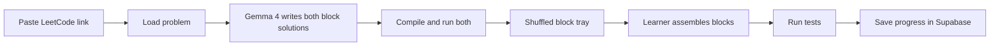

# DeepLock

DeepLock turns a LeetCode problem into a Scratch-style puzzle. A learner pastes a problem link. Gemma 4 writes two solutions, a brute-force one and an optimized one, as blocks. The learner snaps those blocks together and submits. The puzzle is solved when the assembled program passes the tests.

The point is the path into the problem, not a scoreboard. Someone who does not know how to start a LeetCode problem can still see the plan, place the steps, and watch the slow idea become the fast one.

## Product loop

1. Paste a link such as `https://leetcode.com/problems/two-sum/`.
2. DeepLock loads the public problem and asks Gemma 4 for both approaches.
3. The server checks that both approaches compile and agree on the tests. Only then does the puzzle open.
4. The learner builds the brute-force solution from a shuffled tray of blocks, then the optimized one.
5. Each submit runs the assembled blocks against the tests. A pass is saved to their progress.



Brute force comes first on purpose. The nested loop, the extra scan, the sort-and-scan: that version is how most people actually discover the problem. The optimized round then reuses the blocks that still matter and introduces the new idea (a map, two pointers, a stack). Passing the slow version with the fast blocks is fine. DeepLock marks that round solved and moves them on.

## What a puzzle is

The learner never edits Python. They connect blocks. Blockly renders the workspace. A small fixed catalog of blocks is the whole language, so a solution is data, not an arbitrary script.

Gemma does not invent syntax, and it does not emit Blockly XML. It fills in a JSON graph using block types DeepLock already knows. A compiler on the server turns that graph into Python. The same compiler turns the learner's workspace into Python at submit time. If a block type is not in the catalog, the generation is rejected and retried.

### Block catalog

Statement blocks, snapped in a vertical stack:

| Block | What it teaches |
| --- | --- |
| `create` | Make a list, set, map, or number |
| `assign` | Store a value |
| `append` | Push onto a list |
| `map_set` | Remember a key |
| `set_add` | Remember a membership |
| `for_index` | Walk indexes, including a nested loop |
| `for_each` | Walk values |
| `while` | Walk a condition, used for pointers |
| `if` / `else` | Branch |
| `return` | Answer |

Value blocks, dropped into the holes on those statements:

| Block | Examples |
| --- | --- |
| `var` | `nums`, `target`, `i`, `seen` |
| `number` | `0`, `1`, `-1` |
| `index` | `nums[i]` |
| `map_get` | `seen[complement]` |
| `length` | `len(nums)` |
| `binop` | `target - nums[i]`, `i + 1` |
| `compare` | `i < j`, `seen` has key |
| `in_set` | value already seen |

The function header comes from the problem's Python stub. It starts locked on the canvas. The learner builds the body.

Identifiers are an allowlist: the function parameters, plus names created by `create` and `assign`. A field cannot contain a raw Python expression. That keeps the puzzle Scratch-like, and it keeps model output from becoming an injection into the runner.

### One problem, two graphs

Two Sum, optimized, looks like this once Gemma has filled the catalog:

1. `create` map `seen`
2. `for_index` `i` from `0` to `len(nums) - 1`
3. inside: `assign` `complement` = `target - nums[i]`
4. `if` `complement` is in `seen`
5. `return` `[seen[complement], i]`
6. `map_set` `seen[nums[i]] = i`

The brute-force graph is the nested loop over pairs. Each block carries a one-line hint ("Have we already seen the number that would finish the pair?"). Hints are visible. The connection order is not.

The tray also includes two or three distractor blocks that are legal but wrong for this approach, such as a `call` to sort on the hash-map solution. Unused tray blocks do not fail the attempt. Distractors are what make it a puzzle instead of a dictated transcript.

### When a submit counts

Tests decide whether the program works. Block tags decide whether they built the approach they were asked for.

- **Brute-force round.** The compiled program passes every test. Building the optimized solution here also counts, and skips them ahead.
- **Optimized round.** The program passes every test, and every block tagged `required` for that pattern is present and connected. A nested loop that happens to pass is scored as "this works, and it is the slow version" and does not clear the round.

Order of independent statements is not graded. `create seen` above the loop is required only because the compiler needs the name to exist. Swapping two writes that do not depend on each other still passes.

## Frontend

A Next.js app (App Router, TypeScript, Tailwind) with Blockly. One app serves the UI and the routes that hold the Gemini key. Desktop is the layout we design for. A narrow window gets a single column and a note that the workspace wants more width. Blockly on a phone is a later problem.

### Screens

**Home.** One text field, one button: paste a LeetCode link. Under it, three starter problems (Two Sum, Valid Parentheses, Best Time to Buy and Sell Stock) so a demo still works if the problem fetch fails. A signed-in visitor also sees "continue" on anything they have not finished.

**Sign in.** Email magic link and Google, both through Supabase Auth. Progress is tied to a user, so saving an attempt requires a session. A visitor can still open one puzzle. That attempt lives in memory until they sign in, then the client posts it.

**Puzzle.** Three columns.

- Left: title, difficulty, tags, the prompt in plain text, and the examples. A short plan sits above the blocks, four to six sentences Gemma wrote for this approach ("Check every pair. The pair that adds up to target is the answer.").
- Center: the Blockly workspace. The function block is already there and cannot be deleted. Snap blocks underneath it.
- Right: the tray, shuffled. Each block shows its hint when focused. A toggle switches Brute force / Optimized. The optimized toggle stays locked until the brute-force round is solved, unless they already passed with the fast solution.

Under the workspace: **Check** and a result strip. The strip names how many tests passed, shows the first failing input and the expected output, and never shows the canonical block graph. After a passing optimized solution, an explanation card shows the time and space of both versions and one sentence on what changed.

**Progress.** A list of problems they have opened. Each row is brute-force solved, optimized solved, or still open, plus the number of checks it took. This is the page that has to keep working after a refresh, so it reads from Supabase, not from the puzzle screen's local state.

### Client pieces

| Piece | Job |
| --- | --- |
| `LinkForm` | Validates that the paste looks like a LeetCode problem URL before calling the API |
| `ProblemPanel` | Renders the cached prompt and the approach plan |
| `ApproachToggle` | Switches rounds and locks the optimized round |
| `BlocklyStage` | Owns the workspace, the locked function block, and serialization |
| `BlockTray` | Renders the shuffled bag for the active round |
| `RunResult` | Test summary and the first failure |
| `ExplanationCard` | Shown after the optimized round passes |
| `ProgressList` | Reads the signed-in user's rows |

The workspace is saved as Blockly JSON on each check, and also every few seconds while they are signed in, so a refresh does not clear the canvas. The client never receives the canonical graph, the compiled Python, or which tray items are distractors.

### What the learner sees versus what we store

The puzzle response is safe to put in the browser:

- problem title, difficulty, tags, prompt text, examples
- the plan and the hint on each block
- the bag of blocks for the current round, ids and fields, no `next` pointers
- which round is already solved

The canonical graphs, the Python, and the hidden tests stay on the server.

## APIs

Four systems. The browser only talks to DeepLock. Gemma, LeetCode, and the code runner are server-side.

### DeepLock routes

| Route | Purpose |
| --- | --- |
| `POST /api/puzzles` | Body `{ "url": "..." }`. Returns a puzzle id and the public view. Creates the puzzle on first request for that slug. |
| `GET /api/puzzles/:id` | Public view for a refresh or a shared link. |
| `POST /api/puzzles/:id/attempts` | Body `{ "approach": "brute" \| "optimized", "workspace": { } }`. Compiles, runs, stores the attempt, updates progress. |
| `GET /api/me/progress` | The signed-in user's rows. |

`POST /api/puzzles` can take several seconds the first time a problem is seen. The route returns the cached row after that. Generation is deduped per slug so two people pasting Two Sum do not launch two Gemma calls.

### Gemma 4, through the Gemini API

Gemma 4 is Google DeepMind's lightweight open-weight model. DeepLock uses the hosted version on the Gemini Developer API, which is free for Gemma. It is not an OpenAI model. Google's OpenAI-compatible endpoint serves Gemini models and does not reliably serve Gemma, so the server calls the native Gemini API with `@google/genai`.

| | |
| --- | --- |
| Default model | `gemma-4-26b-a4b-it` (mixture-of-experts, the faster of the two hosted sizes) |
| Fallback | `gemma-4-31b-it`, used once if the smaller model fails the compile-and-agree check |
| Endpoint | `POST https://generativelanguage.googleapis.com/v1beta/models/{model}:generateContent` |
| Key | `GEMINI_API_KEY` from Google AI Studio, only in the server environment |
| Thinking | `thinkingLevel: "high"` while writing a solution. `"minimal"` on the repair call |

Free tier, from the Gemini pricing page (checked October 2026): input, output, and context caching for Gemma 4 are free, and there is no paid tier. Prompts on that free tier may be used to improve Google's products. DeepLock sends the problem statement and the block-catalog instructions. It does not send the user's email, session, or display name.

Rate limits are per Google project and are shown in AI Studio, not as a fixed public number. Caching one puzzle per problem slug is what keeps a demo inside those limits. Apps offered to users in the EEA, the UK, or Switzerland cannot use the free tier, and Gemma has no paid tier to switch to. The hackathon build targets everyone else.

The official Gemma guide documents system instructions, multi-turn chat, and thinking. It does not document schema-enforced JSON for these model ids. DeepLock asks for one JSON object, parses it, and checks it with a schema in our own code. A parse failure or an unknown block type triggers a single repair call that includes the error. If that still fails, the puzzle is marked failed and the UI asks them to try a starter problem.

The generation prompt asks for both graphs, a short plan for each, complexity strings, required-block ids, distractors drawn from the same catalog, and extra test cases. Temperature stays low.

### LeetCode problem text

There is no official public API for this. DeepLock reads public problems through LeetCode's GraphQL endpoint, the same one the problem page uses:

`POST https://leetcode.com/graphql`

The slug is the path segment in `/problems/{slug}`. The query asks for `title`, `content`, `difficulty`, `topicTags`, `exampleTestcases`, `codeSnippets` (Python), `hints`, and `isPaidOnly`. Paid problems are rejected. The HTML prompt is reduced to text before it is shown or sent to Gemma.

This endpoint is unofficial. DeepLock uses it to read public problem text, caches the result, and does not submit code to LeetCode or store a LeetCode session. If a request fails, the three bundled starter problems still open.

### Running code

Assembled blocks become Python, then run in a sandbox. The public Piston API at `emkc.org` has been whitelist-only since February 2026, so DeepLock runs [Piston](https://github.com/engineer-man/piston) itself in Docker.

`POST {PISTON_URL}/api/v2/execute`

```json
{
  "language": "python",
  "version": "3.10.0",
  "files": [{ "name": "main.py", "content": "..." }],
  "stdin": "",
  "run_timeout": 3000,
  "run_memory_limit": 134217728
}
```

The runner wraps the learner's function in a harness that feeds one test at a time and prints JSON results. A three-second timeout and a 128 MB cap are enough for the beginner problems this catalog can express, and they stop a runaway loop. The browser never talks to Piston.

### How a puzzle gets its tests

A test is kept only when it is safe to grade with.

1. Examples parsed from the problem statement.
2. Extra cases Gemma proposed.
3. A case stays only if the brute-force program and the optimized program print the same output.
4. The puzzle is stored only when at least three cases survive, including the statement examples.

That way a wrong expected value from the model cannot become the answer key. Both solutions agreeing on a bug is still possible. The statement examples are the anchor, and a failed example fails the generation.

### Environment

| Name | Where |
| --- | --- |
| `GEMINI_API_KEY` | Server |
| `PISTON_URL` | Server |
| `NEXT_PUBLIC_SUPABASE_URL` | Browser and server |
| `NEXT_PUBLIC_SUPABASE_ANON_KEY` | Browser |
| `SUPABASE_SERVICE_ROLE_KEY` | Server only |

## Database

Supabase (Postgres, Auth, Row Level Security). The anon key can read a user's own progress and the public problem text. It cannot read solution graphs, and it cannot write a passing grade. The Next.js server uses the service role for generation and grading.

### Tables

`profiles` — one row per Auth user, created by a trigger on `auth.users`.

| Column | Notes |
| --- | --- |
| `id` | `uuid` primary key, references `auth.users` |
| `display_name` | From the provider, or the email local-part |
| `created_at` | Default `now()` |

`problems` — cached LeetCode (or bundled) problems. Public read.

| Column | Notes |
| --- | --- |
| `id` | `uuid` primary key |
| `source` | `leetcode` or `bundled` |
| `slug` | Unique with `source` |
| `title` | |
| `difficulty` | `Easy`, `Medium`, `Hard` |
| `tags` | `text[]` |
| `content_text` | Prompt sent to the client and to Gemma |
| `examples` | `jsonb` array of `{ input, output }` |
| `python_stub` | Function signature the locked block uses |
| `is_paid` | Paid slugs are stored only so we do not fetch them again |
| `fetched_at` | |

`puzzles` — one ready generation per problem. No policy for the anon role. Service role only.

| Column | Notes |
| --- | --- |
| `id` | `uuid` primary key |
| `problem_id` | References `problems` |
| `model` | The Gemma id that produced it |
| `status` | `pending`, `ready`, or `failed` |
| `brute` | `jsonb` canonical graph, plan, complexity, hints |
| `optimized` | `jsonb` canonical graph |
| `tests` | `jsonb` the agreed cases |
| `created_at` | |

`attempts` — every check. Users can read their own rows. Inserts happen on the server, because `passed` has to be computed there.

| Column | Notes |
| --- | --- |
| `id` | `uuid` primary key |
| `user_id` | References `profiles`. Null for a visitor who has not signed in. Visitor rows are not written. |
| `puzzle_id` | References `puzzles` |
| `approach` | `brute` or `optimized` |
| `workspace` | `jsonb` Blockly state they submitted |
| `passed` | Tests passed, and required blocks for the optimized round |
| `tests_passed` | |
| `tests_total` | |
| `created_at` | |

`progress` — one row per user per puzzle. This is the table the progress page renders. Users can read their own rows. The server is the only writer.

| Column | Notes |
| --- | --- |
| `user_id` | Part of the primary key, references `profiles` |
| `puzzle_id` | Part of the primary key, references `puzzles` |
| `brute_solved_at` | Null until the first passing brute-force attempt |
| `optimized_solved_at` | Null until the optimized round is earned |
| `attempt_count` | Incremented on every check |

### Row Level Security

- `profiles`: a user can `select` and `update` the row whose `id` is `auth.uid()`.
- `problems`: `select` allowed for anon and authenticated users where `is_paid` is false. No client writes.
- `puzzles`: no anon or authenticated policies. The solution JSON never leaves through PostgREST.
- `attempts` and `progress`: `select` where `user_id = auth.uid()`. No `insert` or `update` for the client roles.

Signing in is Supabase Auth. Enabled providers for the hackathon are email magic link and Google. The `on_auth_user_created` trigger inserts the profile.

### Why grades are not writable by the client

If the browser could insert into `progress` or set `attempts.passed`, the progress page would be cosmetic. The attempt route is the only place that compiles a workspace, runs Piston, and then upserts `progress`. The client displays the JSON that route returns.

## Generation, step by step

1. Parse the URL. Accept `leetcode.com/problems/{slug}` and reject anything else.
2. Read `problems` by slug. On a miss, call GraphQL, store the row, and stop if `isPaidOnly` is true.
3. Read `puzzles` for that problem. A `ready` row returns immediately.
4. Call Gemma with the catalog, the stub, the prompt text, and the examples. Ask for both graphs.
5. Validate the JSON against the catalog and the symbol allowlist.
6. Compile both graphs. Run both in Piston. Keep tests they agree on.
7. On failure, one repair call with the validator or runner error attached. The fallback model is allowed on that call.
8. Store `ready` and return the public view: plans, shuffled bags, hints, and no edges.

A `pending` row older than a couple of minutes is treated as abandoned so a crashed request does not block the slug forever.

## Hackathon slice

Build in this order:

1. Bundled Two Sum, hand-written block graphs, Blockly workspace, compile to Python, run in local Piston.
2. Supabase Auth, `attempts`, and `progress`, with the check route writing the grade.
3. Gemma generation for a pasted slug, with the agree-on-tests gate.
4. LeetCode GraphQL plus the three bundled fallbacks.
5. The optimized round, required-block check, and the explanation card.

Leave out of this pass: submitting back to LeetCode, languages other than Python, a leaderboard, hint buttons that place the next block, and mobile layout.

## Sources

- [Run Gemma with the Gemini API](https://ai.google.dev/gemma/docs/core/gemma_on_gemini_api) — model ids `gemma-4-26b-a4b-it` and `gemma-4-31b-it`, native `generateContent`, thinking levels, system instructions. Retrieved October 2026.
- [Gemini Developer API pricing](https://ai.google.dev/gemini-api/docs/pricing) — Gemma 4 input and output free, no paid tier, free-tier prompts used to improve Google products. Page dated 2026-10-22.
- [OpenAI compatibility](https://ai.google.dev/gemini-api/docs/openai) — the OpenAI-shaped endpoint is for Gemini models. Gemma is called natively.
- [Piston](https://github.com/engineer-man/piston) — self-hosted code runner. The public `emkc.org` API is whitelist-only as of 2026-02-15.
